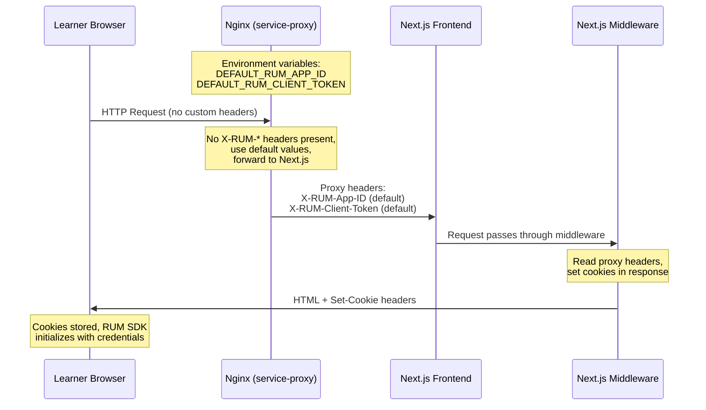

# Storedog - RUM Retention Filters Lab Version

This is a specialized branch of Storedog configured for the RUM retention filters lab. It features a custom RUM configuration system that routes traffic to multiple RUM applications based on the source (puppeteer automated sessions vs. learner browser sessions).

## RUM Configuration Architecture

This branch implements dynamic RUM application routing that allows different traffic sources to send data to different RUM applications. This is essential for the retention filters lab, where learners investigate specific patterns in dedicated RUM applications.

### Learner Sessions

Learner browser sessions (real users accessing Storedog through their browser) don't send custom headers. Nginx uses default RUM credentials from environment variables and forwards them to Next.js, where middleware sets cookies in the response.



**Key Differences:**

| Aspect                 | Puppeteer Sessions                   | Learner Sessions              |
|------------------------|--------------------------------------|-------------------------------|
| RUM Credentials Source | Custom HTTP headers per request      | Default environment variables |
| Session Debug Panel    | Hidden                               | Visible                       |
| User Type              | Random fake users (various personas) | "Learning Center User"        |

## Service changes

### Backend

Has an extra endpoint for the about-us page. This is to illustrate poor Largest Contentful Paint performance on the frontend. This must be used in conjunction with Puppeteer sessions that visit the /about-us page on Storedog's frontend.

### Nginx

Reads custom headers from puppeteer (or uses defaults for learners) and forwards them as proxy headers to Next.js. The headers are as follows:

- `X-RUM-App-ID` - RUM application ID
- `X-RUM-Client-Token` - RUM client token

Configuration is in [`services/nginx/default.conf.template`](services/nginx/default.conf.template).

### Frontend

RUM configuration is handled at runtime via Next.js middleware ([`middleware.ts`](services/frontend/middleware.ts)):

1. Reads `X-RUM-App-ID` and `X-RUM-Client-Token` headers forwarded by nginx
2. Sets `rum_app_id` and `rum_client_token` cookies in the response
3. Browser JavaScript reads these cookies to initialize the RUM SDK

There is a [RUM Debug popover](services/frontend/components/SessionDebugPanel.tsx) in Storedog that displays when a learner visits Storedog. The popover displays live RUM Events and updates to help illustrate how often new RUM Events/updates are generated and indicate how often they will be evaluated against the RUM Application's Retention filters.

### Puppeteer

The Puppeteer service was significantly refactored for this branch. See [`services/puppeteer/README.md`](services/puppeteer/README.md) for full documentation.


### Enable SSL/TLS on the service proxy

By default, the service-proxy serves plain HTTP on port `80`. This is fine when a lab is reached through Instruqt's learner proxy (`*.env.play.instruqt.com`), since Instruqt terminates HTTPS for you there. Some labs instead expose Storedog through Instruqt's external ingress (`*.instruqt.io`), which is unauthenticated and does not terminate HTTPS on Storedog's behalf. In that case, the service-proxy needs to terminate its own TLS, which is what `ENABLE_SSL` is for.

Situations where a lab typically needs this:
- Datadog Synthetic browser tests, which need a valid HTTPS URL to run reliably against the lab
- Demonstrating browser features that require a secure context (for example, Service Workers or WebAuthn)
- A lab where an external service needs a stable public URL to call back into Storedog (for example, webhooks), rather than Instruqt's session-scoped learner proxy
Internal service-to-service traffic (`NEXT_PUBLIC_FRONTEND_API_ROUTE`, Puppeteer's `STOREDOG_URL`, both defaulting to `http://service-proxy:80`) is unaffected by `ENABLE_SSL`, since `listen 80;` always stays present in the generated config regardless of this setting. No other service's configuration needs to change.

> [!IMPORTANT]
> When `ENABLE_SSL` is set to `true`, the `service-proxy` container looks for a certificate and key at `/etc/nginx/certs/cert.pem` and `/etc/nginx/certs/key.pem`. If they aren't already mounted there, it tries to download them from GCP instance metadata. Otherwise, the service-proxy exits with an error on startup.

- `ENABLE_SSL`: Enables HTTPS on the service-proxy container, listening on port `443`. The entrypoint treats unset as disabled, but this branch's `docker-compose.yml` sets `ENABLE_SSL=${ENABLE_SSL:-true}`, so it is on by default here. Only the exact value `true` enables it; any other value, including unset, is treated as disabled.

**How to use**

#### Docker Compose

1. Add these to the `service-proxy` service in your `docker-compose.yml` file:

    ```yaml
    service-proxy:
      ports:
        - '443:443'
      environment:
        - ENABLE_SSL=${ENABLE_SSL:-true}
    ```

1. Start the app via `docker compose up -d`. With nothing mounted, the container downloads the cert/key from GCP instance metadata on startup. To use your own cert/key instead, add a `./certs:/etc/nginx/certs:ro` volume and place them at `./certs/cert.pem` and `./certs/key.pem` before starting.

#### Kubernetes

No cert volume is needed: the `service-proxy` container fetches its own certificate and key from GCP instance metadata at startup, the same way it does for Docker Compose when nothing is mounted.

1. Replace your entire `k8s-manifests/storedog-app/deployments/nginx.yaml` file with [`services/nginx/k8s-manifests/nginx-ssl.yaml`](./services/nginx/k8s-manifests/nginx-ssl.yaml), the same way `services/ads/k8s-manifests/ads-python.yaml` backs the A/B testing instructions above. It adds `ENABLE_SSL=true`, `containerPort: 443`, and a matching Service `port: 443` to the base manifest.

> [!NOTE]
> This only works if the `service-proxy` pod is scheduled onto a VM with `provision_ssl_certificate: true` in its `config.yml` (or a single-node cluster, where that's the only VM). In a split control-plane/worker topology, that usually means the worker node exposed via external ingress.

